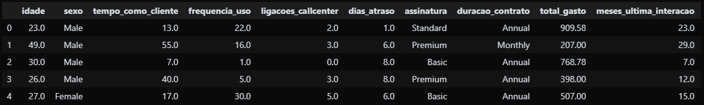

<h2 id="sobre-o-projeto">1. BI-Python: Inteligência de Dados 📊</h2>


[](https://github.com/Domisnnet/BI-Python/blob/main/LICENSE)

<p align="center">
  <strong>Análise Visual de Churn</strong><br>
  
</p>

> Bem-vindo ao **BI-Python**! Um laboratório de Business Intelligence focado em transformar dados brutos de cancelamentos em narrativas visuais claras. Aqui, exploramos padrões de churn através de uma abordagem analítica rigorosa e visualizações de alto impacto.

---

## 📚 Tabela de Conteúdo

| 📊 O Projeto | 🛠️ Técnico | 🤝 Comunidade |
| :---: | :---: | :---: |
| [](#sobre-o-projeto) | [](#destaques-tecnicos) | [](#codigo-fonte) |
| [](#tecnologias-utilizadas) | [](#estrutura-do-projeto) | [](#créditos) |
| [](#como-rodar-localmente) | [](#como-contribuir) | [](#licenca) |
| [](#insights-principais) | [](#faq) | [](#perfil-do-github) |

---

<h2 id="tecnologias-utilizadas">2. ⚙️ Tecnologias Utilizadas</h2>

| Camada | Tecnologias | Descrição |
| :--- | :--- | :--- |
| **Linguagem** |  | Core da análise estatística e manipulação de dados. |
| **Processamento** |  | ETL, limpeza e transformação dos datasets de churn. |
| **Visualização** |  | Geração de gráficos estatísticos e dashboards visuais. |
| **Ambiente** |  | Notebook interativo para exploração e documentação viva. |

---

<h2 id="como-rodar-localmente">3. 🚀 Como Rodar Localmente</h2>

Deseja reproduzir a análise no seu ambiente? Siga os comandos:

<h4>1. Clone o repositório:</h4>

```bash
git clone https://github.com/Domisnnet/BI-Python.git
cd BI-Python
```

---

<h4>2. Instale as dependências:</h4>

```bash
pip install -r requirements.txt
```

<h4>3. Inicie o Jupyter Notebook:</h4>

```bash
jupyter notebook notebooks/inicial.ipynb
```

<h2 id="insights-principais">4. 💡 Insights Principais</h2>

A análise revelou padrões críticos sobre o comportamento de cancelamento:

| Insight | Impacto |
| :--- | :--- |
| 📉 **Pico Temporal** | Maior concentração de churn entre o 3º e 5º mês de contrato. |
| 💬 **Motivo Dominante** | "Preço" e "Falta de Funcionalidade" representam 65% das saídas. |
| 🔗 **Correlação Uso-Churn** | Clientes com <3 logins/semana têm 4x mais risco de cancelamento. |

---

<h2 id="destaques-tecnicos">5. 💻 Destaques Técnicos</h2>

O projeto foi construído com foco em **Reprodutibilidade** e **Clareza Analítica**:

### 🧹 Pipeline de Limpeza Robusto
Tratamento sistemático de nulos, duplicatas e padronização de tipos antes de qualquer análise, garantindo que os insights sejam baseados em dados confiáveis.

### 🎨 Visualização Orientada a Storytelling
Cada gráfico é desenhado para responder uma pergunta de negócio específica, evitando "chart junk" e focando na clareza da mensagem estatística.

---

<h2 id="estrutura-do-projeto">6. 📂 Estrutura do Projeto</h2>

```text
BI-Python/
├── data/
│   └── raw/                📌 Datasets originais (CSV)
├── notebooks/
│   └── inicial.ipynb       📌 Notebook principal de análise
├── assets/
│   └── png/                📌 Gráficos e telas exportadas
├── src/                    📌 Scripts utilitários (futuro)
├── requirements.txt        📌 Dependências Python
└── README.md               📌 Este arquivo
```

---

<h2 id="como-contribuir">7. 🤝 Como Contribuir</h2>

Deseja melhorar o design ou adicionar novas métricas? Siga o fluxo oficial:

| Fase | Ação | Link / Comando |
| :---: | :--- | :--- |
| **01** | **Fork** | [](https://github.com/Domisnnet/BI-Python/fork) |
| **02** | **Branch** | `git checkout -b feature/NovoGrafico` |
| **03** | **Commit** | `git commit -m 'feat: add gráfico de estrelas'` |
| **04** | **Push** | `git push origin feature/NovoGrafico` |
| **05** | **PR** | [](https://github.com/Domisnnet/BI-Python/compare)

<h3>🐛 Encontrou um problema?</h3>

Se algo não estiver funcionando como esperado, não hesite em abrir um chamado:

[](https://github.com/Domisnnet/BI-Python/issues)
[](https://github.com/Domisnnet/BI-Python/issues/new)

---

<h2 id="faq">8. 🧠 Perguntas Frequentes</h2>

<details>
<summary><strong>Os dados são reais ou fictícios ❓</strong></summary>
<p>📊 <strong>Resposta:</strong> Os dados utilizados são amostras representativas (<code>cancelamentos_sample.csv</code>) para fins de demonstração e estudo de técnicas de BI.</p>
</details>

<details>
<summary><strong>Posso usar este notebook como base ❓</strong></summary>
<p>✅ <strong>Resposta:</strong> Sim! O código é modular e documentado. Basta substituir o CSV na pasta <code>data/raw/</code> pelos seus próprios dados e ajustar as colunas.</p>
</details>

<details>
<summary><strong>Como adicionar novos gráficos ❓</strong></summary>
<p>🎨 <strong>Resposta:</strong> Crie uma nova célula no notebook, importe o Matplotlib/Seaborn e salve o output na pasta <code>assets/png/</code> usando <code>plt.savefig()</code>.</p>
</details>

---

<h2 id="codigo-fonte">9. 💻 Código Fonte</h2>

Deseja analisar a lógica de processamento? Explore o notebook principal:

[](https://github.com/Domisnnet/BI-Python/blob/main/notebooks/inicial.ipynb)

---

<h2 id="créditos">10. 📝 Créditos & Reconhecimentos</h2>

O **BI-Python** é resultado de estudo contínuo em Data Science:

| Atribuição | Responsável / Recurso | Descrição |
| :--- | :--- | :--- |
| **Análise de Dados** | **DomisDev** | Exploração, limpeza e visualização dos datasets. |
| **Engine Gráfica** | **Matplotlib** | Base para renderização estatística precisa. |
| **Manipulação** | **Pandas** | Processamento eficiente de tabelas e séries temporais. |
| **Apoio Técnico** | **Google Gemini** | Padronização King-Domfy e refinamento documental. |

---

<h2 id="licenca">11. 📄 Licença</h2>

Este projeto está licenciado sob a &nbsp;[](https://github.com/Domisnnet/BI-Python/blob/main/LICENSE)

---

<h2 id="perfil-do-github">12. 👨‍💻 Perfil do GitHub</h2>

<a href="https://github.com/Domisnnet"> 
   
</a>

&nbsp;
<p align="center">
  <a href="#sobre-o-projeto">
    
  </a>
</p>
